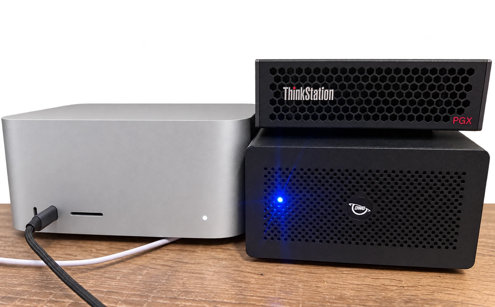

# Mac + Spark playbook: prefill on a DGX Spark, decode on a Mac Studio



*The pair: Mac Studio M3 Ultra (left); Lenovo ThinkStation PGX, a GB10 Spark (top right); and the OWC Helios 5S
holding the ConnectX-5 Ex (bottom right). One Thunderbolt 5 cable runs from Mac to Helios, and one 40G QSFP+ cable
from Helios to Spark.*

This repository shows how to serve one large model from two machines:

- An **NVIDIA GB10 Spark** prefills long prompts, where its compute is strong.
- An **Apple M3 Ultra Mac Studio** decodes the answer, where its memory bandwidth is strong.
- The model state moves between them over RDMA, through a ConnectX-5 in a Thunderbolt 5 enclosure cabled to the
  Spark's ConnectX-7.

The model is **Qwen3.8 Flash Next**, a hybrid of linear-attention, sparse-attention and short-conv layers. The Mac
drafts with its MTP head, and the Spark sends that head's cache over the prompt too.

It works and serves an OpenAI-compatible endpoint. It is not a product: it runs on a macOS beta with SIP off, a
patched driver, and fork branches with open pull requests. Everything below names its source and status.

## Results in short

Full tables, method and anomalies are in [docs/benchmarks.md](docs/benchmarks.md). The setups compared:
- **Split:** this playbook.
- **Mac only:** the same oMLX.
- **TensorFold on one Spark:** the fastest single-Spark server for this model, with its own drafts.

Each setup ran 24 runs, from 500 to 64k prompt tokens, on prose and on code. Every answer was checked.

| 512-token answer | Split | Mac only | Spark only (TensorFold) |
|---|---:|---:|---:|
| Prose, 8k prompt: first token / total | 5.2 s / 13.3 s | 9.4 s / 17.4 s | **3.1 s** / 13.9 s |
| Prose, 56k prompt: first token / total | 27.9 s / 36.5 s | 72.7 s / 81.7 s | **23.0 s / 35.1 s** |
| Code, 10k prompt: first token / total | 6.8 s / 11.4 s | 13.8 s / 18.7 s | **6.3 s / 8.3 s** |
| Code, 64k prompt: first token / total | **34.5 s / 40.6 s** | 84.4 s / 91.1 s | 57.5 s / 60.8 s |
| Decode, prose (8k and up) | **58–63 tok/s** | 45–64 tok/s | 42–48 tok/s |
| Decode, code that copies the prompt | 85–116 tok/s | 77–114 tok/s | **149–262 tok/s** |

In short:
- **Code, long prompts:** the split wins from about 32k tokens on. vLLM prefills code on the Spark at about
  2,100 tok/s, against TensorFold's 1,100–1,600.
- **Code, shorter prompts:** TensorFold wins, because its drafts copy from the prompt more than twice as fast as
  oMLX's MTP head.
- **Prose:** the split and TensorFold finish level, and TensorFold gives the first token 2–5 s sooner.
- **Mac alone** decodes like the split but prefills at 700–850 tok/s.

The KV-cache handoff itself adds:
- 0.35–1.9 s of transfer at about 8.5 Gbit/s;
- about 1.7 s of setup on the Mac.

## What you need

| Part | Where it comes from | Status |
|---|---|---|
| RDMA driver for the Mac's CX5 | [ashhart/MCDMA](https://github.com/ashhart/MCDMA) 0.1.18 | upstream |
| ↳ macOS 27.2 beta `26B5101f` support | [ashhart/MCDMA#17](https://github.com/ashhart/MCDMA/pull/17) | open PR |
| ↳ link setup over the LAN (a Spark has no Thunderbolt networking) | [ashhart/MCDMA#18](https://github.com/ashhart/MCDMA/pull/18) | open PR |
| ↳ port recovery after a link flap | [ashhart/MCDMA#19](https://github.com/ashhart/MCDMA/pull/19) | open PR |
| vLLM connector that exports the hybrid state and the MTP head's cache | [ashhart/MCDMA#20](https://github.com/ashhart/MCDMA/pull/20) | open PR |
| **All four combined** | [Aileuxe/MCDMA `playbook`](https://github.com/Aileuxe/MCDMA/tree/playbook) | use this until they merge |
| oMLX remote prefill (KV handoff decoder) | [jundot/omlx#3941](https://github.com/jundot/omlx/pull/3941) from [ashhart/omlx `feat/remote-prefill`](https://github.com/ashhart/omlx/tree/feat/remote-prefill) | open PR |
| ↳ hybrid handoffs and MTP-head priming | [ashhart/omlx#1](https://github.com/ashhart/omlx/pull/1) from [Aileuxe/omlx `feat/remote-prefill-hybrid`](https://github.com/Aileuxe/omlx/tree/feat/remote-prefill-hybrid) | open PR; use this branch |
| vLLM with Flash Next, b12x kernels and MTP | `eugr/spark-vllm-b12x:nightly-20261009` (Docker Hub) | prebuilt image |
| Spark checkpoint | [`local-inference-lab/Qwen3.8-Flash-Next-NVFP4`](https://huggingface.co/local-inference-lab/Qwen3.8-Flash-Next-NVFP4) | Hugging Face |
| Mac checkpoint | [`Jundot/Qwen3.8-Flash-Next-oQ4e-mtp`](https://huggingface.co/Jundot/Qwen3.8-Flash-Next-oQ4e-mtp) | Hugging Face |

Hardware:
- Mac Studio M3 Ultra with 256 GB; the Mac model is about 104 GB;
- ConnectX-5 Ex in an OWC Helios 5S on Thunderbolt 5;
- a 40G QSFP+ cable;
- a GB10 Spark; ours is a Lenovo ThinkStation PGX.

The Thunderbolt cable we used is labelled TB4 and negotiates the full 80 Gb/s with the Helios. Both machines also
need a shared LAN segment, where the link daemons meet.

## Layout

```
config.env.example       every site-specific value; copy to ~/.config/mac-spark-playbook/config.env
docs/setup.md            the steps, in order, with how to check each one
docs/benchmarks.md       split vs Mac only vs one Spark: prefill, first token, decode, prose and code
docs/pitfalls.md         what cost us time, and the fix
mac/                     restore job for the link, LaunchAgents for the link daemon and oMLX
spark/                   neighbour restore, link daemon, producer, memory watchdog
bench/                   suite.py (the sweep), report.py (tables), omlx_log_stats.py (handoff breakdown),
                         two quick single-task benchmarks, and the raw results in bench/results/
```

The scripts are generalized from the ones running on our pair. The generalized copies are syntax-checked, but they
have not yet been run on a fresh machine. Expect to adjust names: ours are `mcrdma0`, `rocep1s0f1`, `enP7s7`.

## Contributing

Fixes and results from other hardware are welcome here as issues or pull requests. Changes to the driver,
connector or decoder belong in the upstream repositories above.

## Credits

- **[Ash Hart](https://github.com/ashhart):** MCDMA, the KV-handoff protocol and oMLX's remote prefill.
- **[jundot](https://github.com/jundot):** oMLX, Lightning MTP and the oQ checkpoints.
- **[eugr](https://hub.docker.com/u/eugr):** the Spark vLLM build with b12x kernels.
- **local-inference-lab:** the NVFP4 checkpoint.

The hybrid and MTP handoff, the fixes above and this playbook are by Alexander Deutsch, written with
[Claude Code](https://claude.com/claude-code).

MIT license; see `LICENSE`. The linked projects keep their own licenses.
